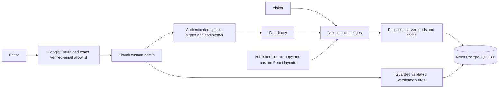
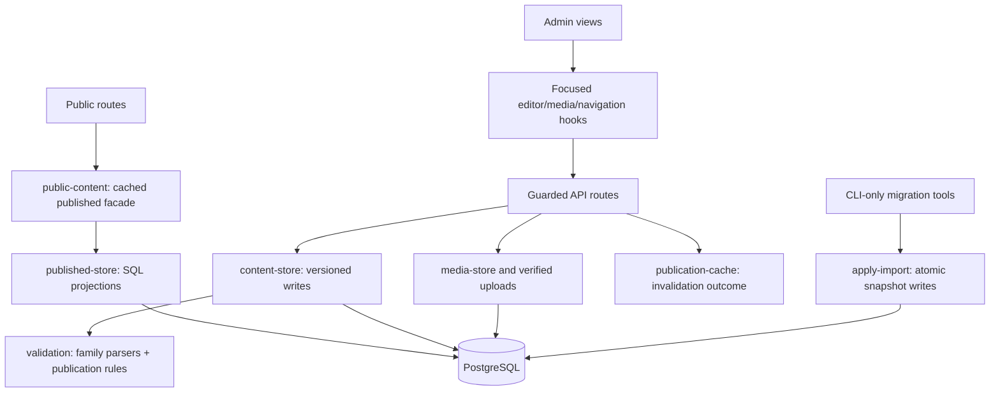

# Implemented architecture

[Overview](README.md) · [Plan and evidence](plan.md) · [Decision log](decisions.md)

The integrated implementation lives in [`remake/`](../../README.md).
Public and admin flows use the same Next.js application and replacement
PostgreSQL schema. Local behavioral checks and the hosted Neon import have run;
a Vercel preview is deployed and hosted recovery was rehearsed. Live Google OAuth and production
cutover remain separate release work.

## System boundary

The pinned application uses Next.js 16.4.3, React 19.3.1, TypeScript 5.9.3,
Node 22.23.4 and npm 10.9.9; exact dependency versions are in its own lockfile.
CSS Modules share Ubuntu fonts and blue/gold design tokens. Drizzle and `pg`
manage PostgreSQL; Better Auth supplies stateless Google sessions; Tiptap supplies
visual editing of a restricted JSON tree. There is no separate backend or
replacement general CMS. The owner's new Vercel project targets `remake/` on
Node 22 and runs a preview against the free Frankfurt Neon resource `farazv`.
Hosted counts match the local import: 414 content, 1,081 media and 30 static
provenance records. This preview has not replaced the production site or DNS.

## Module map

The [contributor task map](../../README.md#find-the-owner-of-a-change)
points to file owners. Runtime queries, commands and private migration tools have
separate entry points:

`ContentDocumentMap` correlates each record kind with its draft/published document;
forms and previews narrow that union explicitly. Historical quarantined records
are decoded without applying new-publication rules. `http.ts` owns the bounded
JSON stream reader/private headers; operation boundaries retain explicit auth and
same-origin checks. `scripts/environment.ts` lazily loads CLI configuration with
process-variable precedence. No runtime module imports CLI migration tooling.

## Storage and content contracts

[Shared contracts](../../src/content/documents.ts),
[database schema](../../src/server/db/schema.ts) and
[write validation](../../src/server/validation.ts) define the implemented
model. Four application tables hold content snapshots, media references, static
source provenance and import runs; Drizzle tracks schema migrations separately.
No old Strapi account/configuration tables or new auth tables are imported.

**Content records** have kinds article, news, notice, event, bulletin and settings.
Each holds a draft, separate published snapshot, atomic edit version, source
identity/hash/timestamps, public identity and eligibility/read-only state. Saving
never changes the public snapshot. Publishing validates and updates it in one
version-checked write; concurrent stale writes fail without replacing the form.
Published paths stay reserved after unpublication. Uniqueness follows actual
route families: news/events share `/prispevky/`; articles and notices have their
own families. Three legacy article/news slug overlaps remain separate records.

**Editorial content** has title, stable slug, historical display date, excerpt,
author text, optional cover and canonical rich-text body. Poster placement,
destination, expiry and news-list visibility belong to that same record. Posters
preserve full image proportions and their detail URLs. A destination takes
priority; otherwise meaningful detail opens its page, with an image viewer for
image-only treatment. Editorial publication is immediate; the display date is
not a scheduling control. All 146 imported articles are public by the user's
one-time exception; future drafts and unpublished news do not inherit it.
The importer converts source leads/fallbacks into bounded plain-text summaries,
separate from the complete canonical body. All 146 imported article excerpts
were verified at 25–300 characters after the final source-projection correction;
that correction changed no canonical article body.

**Bulletins** own Monday–Sunday dates, typed Mass rows, liturgy text, announcements
and optional donation rows. Donation categories remain simple text; a real amount
may have a blank donor label. Publication rejects rows with neither name nor
amount and invents neither. New weeks copy only regular times, locations and
labels. Source metadata and nine anomalous/duplicate weeks remain preserved;
those nine are read-only and ineligible, while 153 valid historical weeks remain
editable. Editing an old week does not make it current. There is no public
history browser or historical-intentions API.

**Settings** are the shared source for parish contacts, mobile/address/IČO,
contact/office notes, map link, priests, office hours, Náuky, IBAN/QR and recurring
Mass times. Settings support draft/preview/publication but cannot be unpublished.
Changing IBAN requires replacing or removing an unchanged QR reference. Template
changes affect future weeks/fallback only, never a published week's snapshot.
The imported recurring template is empty because the source does not confirm it.
New settings start with blank required facts and empty lists; publication requires
the real facts to be completed. Demo settings never supply production defaults.

## Public reading and information layouts

Server-only functions expose published snapshots and bounded summary queries.
The magazine starts with ten summaries and requests six more per click using
stable date/ID cursors. Bodies and private fields do not travel in list responses.
News, posters, expiry, authors, coverless articles, retries and end states use the
same content identities. The homepage avoids duplicate poster/news placements.

The 24 informational definitions select purpose-designed sacrament, church,
community, school, contact, gallery and resource layouts. Server-only reading
copy contains the 29 published source pages, preserving ordered text, images,
collections and credits; the unpublished page stays private. This uses rich text
inside reading areas without recreating the old page builder. Shared facts come
from published settings. Static reading-copy/layout changes remain code changes.
A later user-authorized refresh uses explicit guarded corrections in
`information-updates.ts`; the raw 29-record source export remains intact. Current
approved public reading has 224 blocks. See [the editorial record](content-refresh-2026-10-31.md).
Real photograph constants live in `assets.ts`; synthetic examples stay in explicit
`fixtures.ts`. Each route declares source or curated-fallback ownership; expected
missing source fails rather than silently showing shortened prose.

The independent baseline protects the raw 29 records, 24 route definitions and
reviewed current reading. Evergreen/history content stays preserved. The user
authorized specific expired-guidance corrections; further substantive changes
require an editorial request. Gentle headings/introductions and layout changes
remain allowed. Do not invent current dates, automatically archive old passages,
or expose legacy SEO/editor-note fields as reading copy. See the earlier
[content fidelity review](../static-content-review.md).

All 28 fixed legacy paths, dynamic detail families and four `/cms/` redirects are
mapped. Birmovanci appears under Sviatosti with its path intact. Existing Forms,
public PDF, map and safe 3D resources use explicit links/fallbacks. Old tour URLs
are withheld following the specific unrelated-content finding recorded in the
[route map](../routes.md#redirects-and-external-resources).

## Authentication and editing

Every admin page/read, private preview, mutation and upload endpoint verifies
Better Auth's signed/encrypted session, verified email, expiry and the current
exact allowlist. Google is the only provider; email/password signup and account
linking are disabled. Sessions last eight hours without an auth database.
Configuration is lazy and missing values fail closed. Mutations additionally
require the configured same origin; admin responses/previews are private,
uncached and noindex. Page redirects are a convenience, not the access boundary.
Vercel admin page visits on an alternate alias first redirect to the configured
HTTPS auth origin with path/query intact. The narrow server proxy handles only
GET/HEAD `/admin` pages, leaves local development alone unless Vercel mode is
explicit, and does not redirect APIs or relax trusted origins.

The Slovak editor includes rich-text tools, media selection, draft save, private
preview, publish/unpublish and settings/bulletin forms. Structural validation
permits incomplete titles/URLs/body drafts while rejecting malformed shapes,
unsafe links/images and excessive input. Publication requires meaningful content.
Legacy blocks normalize into the same canonical JSON schema. The server renders
validated React elements and does not execute source HTML or ship Tiptap to public
pages. Dirty-navigation warnings, save/error states, version-conflict recovery
and upload/cache retries retain the editor's values. Retrying cache refresh does
not republish content. Autosave, roles and approval workflows are outside v1.

## Dates, caching and failures

Calendar dates and local Mass times use `Europe/Bratislava`. The public view is
Sunday–Sunday; the preceding Sunday is read from its owning record. Applicable
windows begin on the preceding Sunday, with the later valid week winning an
overlap. Unpublishing it permits another valid overlapping week before fallback.
Missing schedules differ from a deliberately confirmed day without Masses.
Fallback uses only available published regular times, clearly labeled and without
guessed liturgy, intentions or celebrants.

Published reads use tagged five-minute caches scoped to the database connection.
Publication invalidates the data tag and public layout. Today and poster expiry
are calculated outside timeless caches; expiry is inclusive of the local date.
The client refreshes at local midnight and on returning to a background tab,
including 23/25-hour DST days. Future weeks activate without another edit/deploy.

Command-line imports write the database directly. Follow the [explicit cache
refresh procedure](../operations.md#refresh-after-a-command-line-import)
before reviewing their public output; a deployment alone can retain cached data.

Database failures remain errors, not empty lists, invented fixture contacts or
false missing-article 404s. Section-level unavailable states keep navigation and
static reading content usable. A warm cache may serve its published snapshot;
regular-time fallback is not promised when settings are unavailable too.
The cold-database outage check verified a usable HTTP-200 public shell,
HTTP-503 data/health responses and an unavailable detail state instead of a false 404. This evidence does not promise availability beyond the selected services.

## Media and migration

Existing Cloudinary IDs/URLs, dimensions, captions and credits are retained.
Responsive delivery reserves dimensions and lazy-loads thumbnails; full-size
viewer images load when selected. The guarded signer fixes the image namespace,
formats and overwrite protection. Provider signatures last one hour, while an
editor-bound completion ticket lasts five minutes. Completion verifies the
response signature and independently reads provider metadata before registration.
Actual bytes must fit the 10 MB limit. Removing a reference does not delete a
shared original. See [upload constraints and evidence](../operations.md#cloudinary).

The private importer parses an allowlisted SQL content projection, reconstructs
ordered component/media relationships and records source hashes/statuses. It is
repeatable, reports removals/conflicts and preserves target editorial changes and
published paths. Repeat writes compare the version observed in the snapshot at
the database write; concurrent editor saves/publications win and are reported as
conflicts. Same-ID insert races also report a conflict while unrelated imports
continue. Four alternate article bodies were reconciled without duplicate
text; donation category/order and genuine unnamed amounts remain intact.
Public static exports include only published source copy. Detailed evidence is in
[the migration record](../migration.md).

Missing originals remain a recovery limitation: 76 return 404 and five
unreferenced PDFs return 401. The public fallback is implemented, but media
recovery is incomplete. New PDF upload/parsing is deferred; existing public
attachment links remain.

## Release boundary

Fixture mode is an explicit nonproduction demo, never a silent database fallback.
Default previews are noindex with crawling disabled. Production indexing/sitemap
activation requires explicit production configuration; this never replaces draft
access control. CI uses only fixture/synthetic data and disposable local databases.
Backup/restore, access recovery, monitoring and rollback procedures are in the
[operations runbook](../operations.md). Current hosted/freshness,
media and parish-confirmation requirements are tracked in the
[launch checklist](README.md#launch-requirements).
The authorized legacy read-only check timed out without results or changes;
it does not confirm snapshot freshness. Local PostgreSQL 14 and hosted
PostgreSQL 18 recovery drills passed; the hosted archive restored five tables/
1,530 rows with schema, index and sequence hashes matched and source unchanged.
Ongoing encrypted off-device scheduling, retention and ownership still require
activation.
